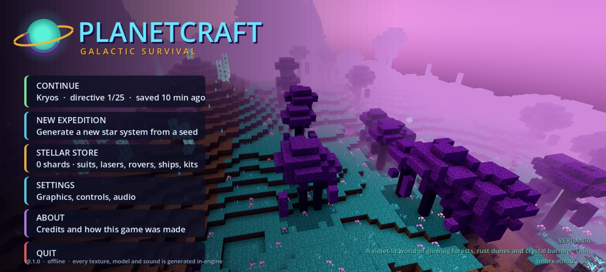
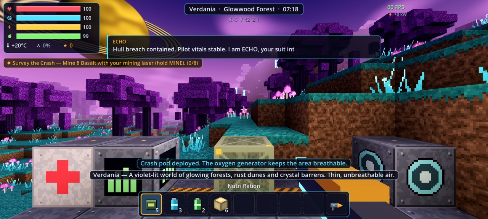
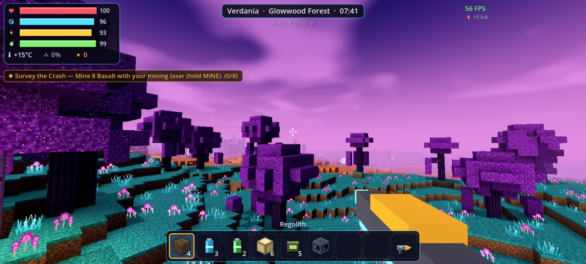
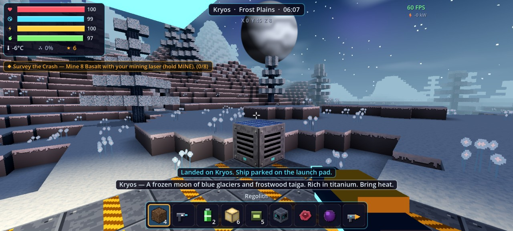
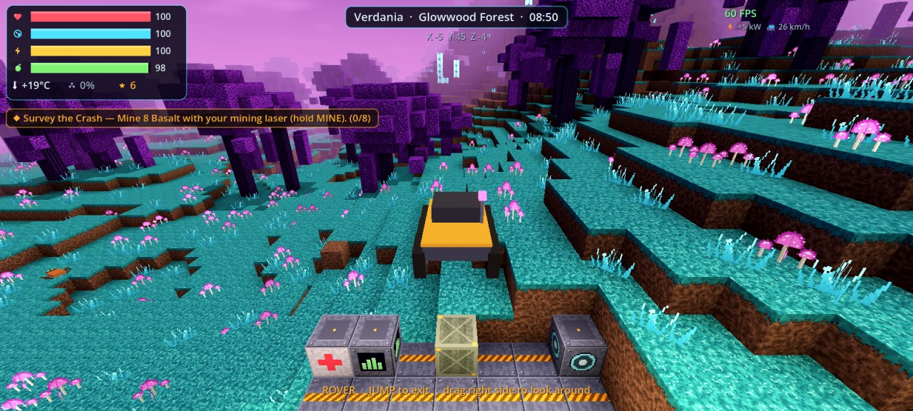
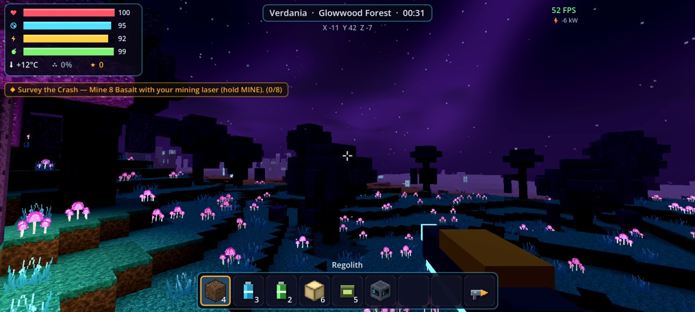
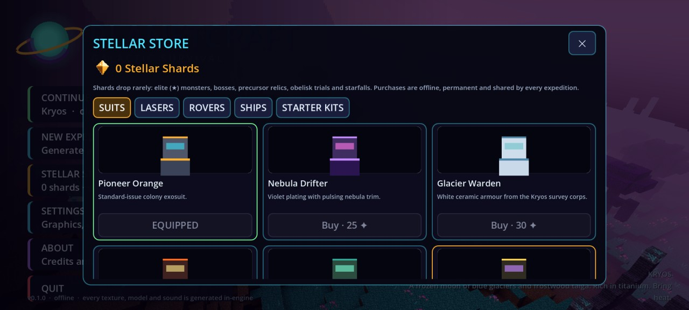
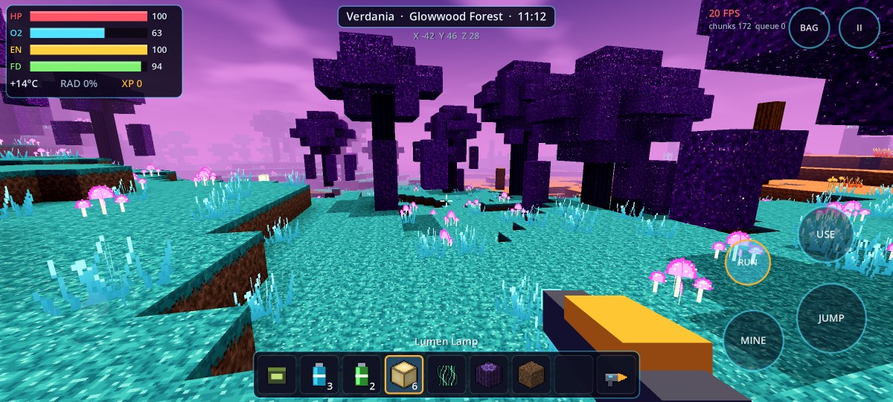

# PlanetCraft: Galactic Survival

An original, fully offline 3D voxel sandbox for Android. Crash-land on an alien world, mine and
build, automate a colony, tame and hunt alien creatures, fly between six worlds and terraform
dead planets into living ones.

Built with **Godot 4.7.2 (GDScript)** and developed with **Kiro CLI**. Kiroween 2026 entry,
**Frankenstein** category.

| | |
|---|---|
|  |  |
|  |  |
|  |  |

Screenshot on the reference phone (Redmi Note 11, Android 13):

## Download

- **APK:** see the [latest GitHub Release](https://github.com/fareza777/planetcraft-kiro/releases/latest)
  (debug-signed build produced by CI). Every push also uploads the APK as a CI artifact.
- Requirements (from the APK manifest): Android 7.0+ (min SDK 24, target SDK 36), arm64-v8a,
  OpenGL ES 3.0 GPU, about 30 MB of storage. The app requests no permissions and works fully offline.
- Tested on: Redmi Note 11 (Snapdragon 680, Adreno 610, Android 13). See [docs/TESTING.md](docs/TESTING.md).

## What is in the game (implemented and tested)

Everything listed here exists in this repository and was exercised by the automated tests or on
the reference device. See [docs/TESTING.md](docs/TESTING.md) for the exact results.

- **Voxel engine:** seed-based terrain for 6 worlds (heightmap, floating islands, asteroid field),
  caves, ore veins, crystal caverns, trees and plants. 16×16×128 chunk columns streamed on worker
  threads, greedy meshing with ambient occlusion, sky-light approximation, edit deltas saved per world.
- **Procedural art and audio:** all 78 block textures, every item icon, creature bodies, the sky,
  28 sound effects and the day/night music are generated by the game's code at startup. The repo
  contains no image or audio assets apart from the SVG app icon.
- **Survival:** health, oxygen, suit energy, food, body temperature, radiation; helmet lamp;
  jetpack; fall damage; storms; respawn at a med bay.
- **Building and crafting:** 61 placeable blocks, 75 data-driven recipes across hand, Fabricator,
  Smelter, Assembler and Refinery stations.
- **Colony and automation:** power grid (solar, battery, reactor), oxygen and heat zones,
  hydroponics, miner drones that fly out and mine ore, auto-smelting, storage crates, and
  production while you are on another planet (time-delta simulation).
- **Alien ecosystem:** 11 creatures with voxel bodies, procedural animation, wander/flee/chase/attack
  AI, distance-based update rates, taming, elite (★) variants and a boss (the Void Guardian).
- **Combat and loot:** ranged and melee weapons, projectiles, damage numbers, loot orbs, rarity tiers,
  16 items of rare rarity or higher, 6 gear recipes that need rare monster drops, a bestiary.
- **Vehicles and space:** drivable rover; launch pad, ship assembly (hull, engine tier, nav computer),
  star map and jumps between Verdania, Kryos, Pyrrhos, Aridus, Nullara and the Kessler Belt.
- **Story and NPCs:** 25-step main story in 6 chapters with narrated beats, 6 NPCs (Haven Outpost on
  Verdania plus survivors on other worlds), 14 side jobs, trading, HUD waypoints and a journal.
- **Living world:** day/night, weather (dust/ash storms, blizzards, spore rain), meteor showers that
  leave craters, gravity anomalies, swaying foliage, procedural structures with events
  (Obelisk trials, Starfall shrines, alien hives, crashed freighters).
- **Planet Evolution:** mining raises pollution; powered terraformers raise atmosphere, water and
  life, change the sky colour, convert ground to soil and grass, and eventually make air breathable.
- **Stellar Store:** offline cosmetic store on the title screen (suits, laser colours, rover and ship
  paint, starter kits) paid with Stellar Shards, a rare account-wide currency.
- **UI:** touch controls (floating joystick, drag-look, tap-to-use, hold-to-mine, vector-icon buttons),
  keyboard and mouse on desktop, tabbed item screen, live settings (view distance, resolution scale,
  bloom, clouds, sensitivity, button size, invert Y, volume).

Planned work and known gaps are listed in [docs/ROADMAP.md](docs/ROADMAP.md).

## Controls

| Action | Touch | Desktop |
|---|---|---|
| Move | Left half: floating joystick | W A S D |
| Look | Drag on the right half | Mouse |
| Mine / fire weapon | Hold **MINE**, or long-press the right half | Left mouse |
| Use / place / talk / drive | Tap **USE**, or tap the right half | Right mouse or F |
| Jump / jetpack (hold in air) / exit rover | **JUMP** | Space |
| Sprint | **RUN** (toggle) | Shift |
| Hotbar | Tap a slot | 1–9, mouse wheel |
| Item screen | **BAG** | E or Tab |
| Pause and settings | **II** | Esc |

More in [docs/GAMEPLAY.md](docs/GAMEPLAY.md).

## Build from source

1. Install Godot **4.7.2** and its Android export templates
   (or run `python tools/fetch_android_templates.py 4.7.2` to fetch only the Android parts).
2. Configure the Android SDK and a debug keystore in Godot's editor settings (or the
   `GODOT_ANDROID_KEYSTORE_DEBUG_*` environment variables).
3. `godot --headless --path . --export-debug "Android" build/PlanetCraft-debug.apk`

Full steps, tests and CI details: [docs/BUILDING.md](docs/BUILDING.md).

## Architecture

Data-driven content in `data/*.json`, two autoloads (`Reg`, `Game`), a voxel core
(`scripts/voxel`), gameplay systems (`scripts/world`, `scripts/player`) and code-built UI
(`scripts/ui`). See [docs/ARCHITECTURE.md](docs/ARCHITECTURE.md).

## How Kiro was used

Steering docs, specs and the full development workflow are in [`.kiro/`](.kiro) and explained in
[docs/KIRO_DEVELOPMENT.md](docs/KIRO_DEVELOPMENT.md). The Frankenstein write-up is in
[docs/FRANKENSTEIN.md](docs/FRANKENSTEIN.md).

## License

Source code and all procedurally generated content: [MIT](LICENSE) © 2026 F7 Developer.
Third-party components and asset provenance: [THIRD_PARTY_NOTICES.md](THIRD_PARTY_NOTICES.md)
and [docs/ASSETS.md](docs/ASSETS.md).
