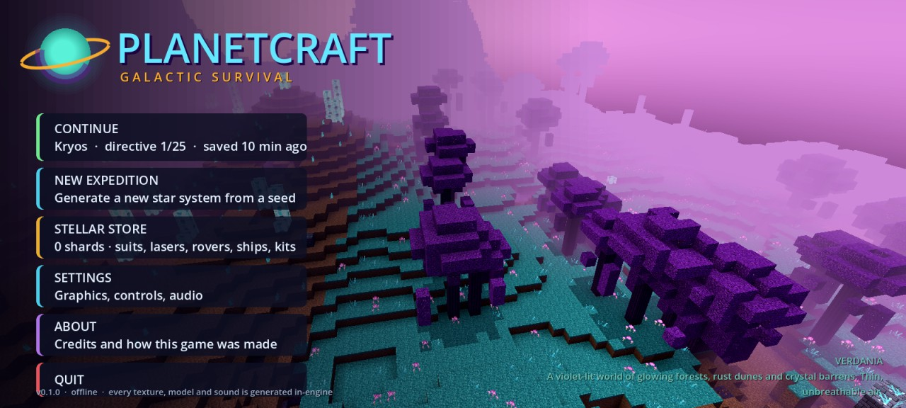
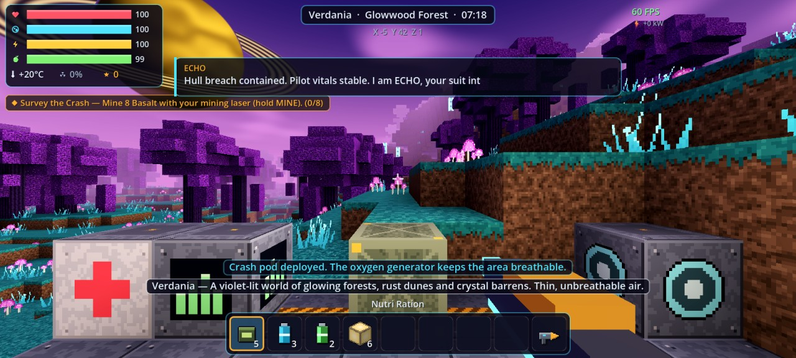
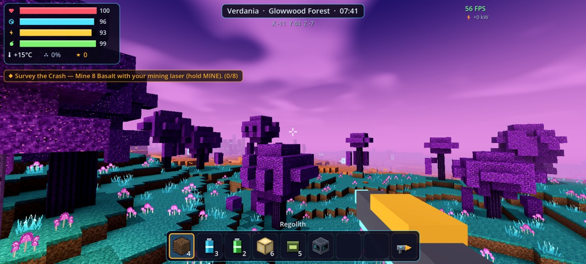
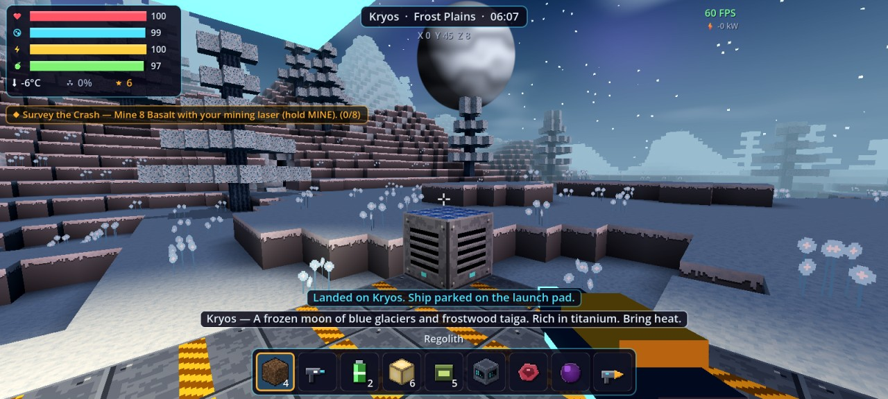
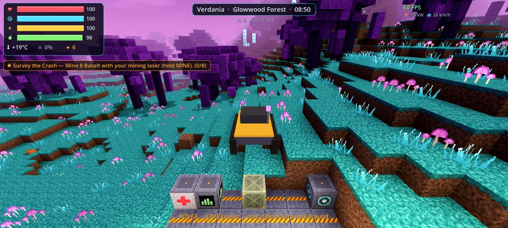
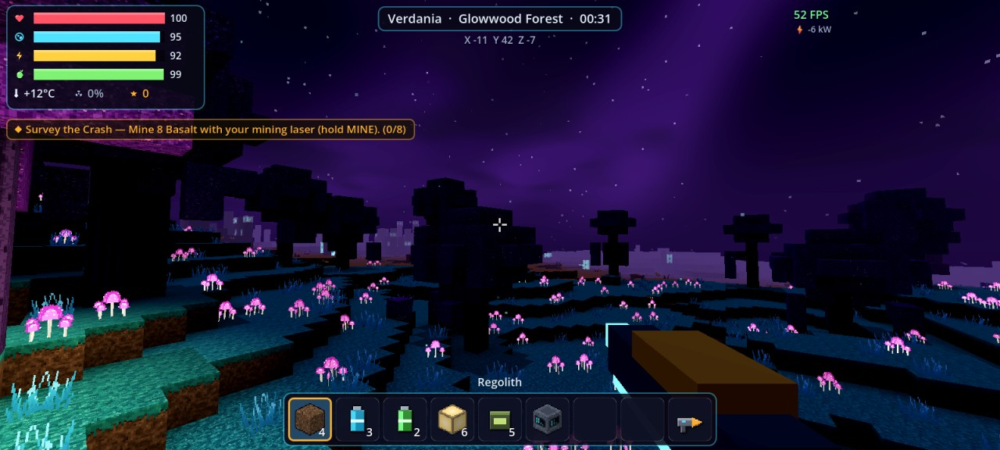
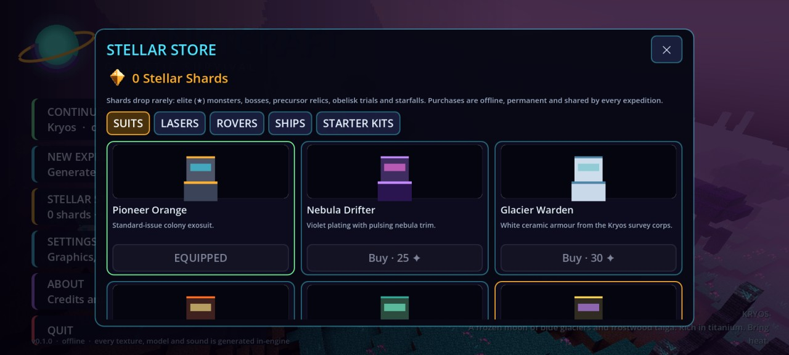
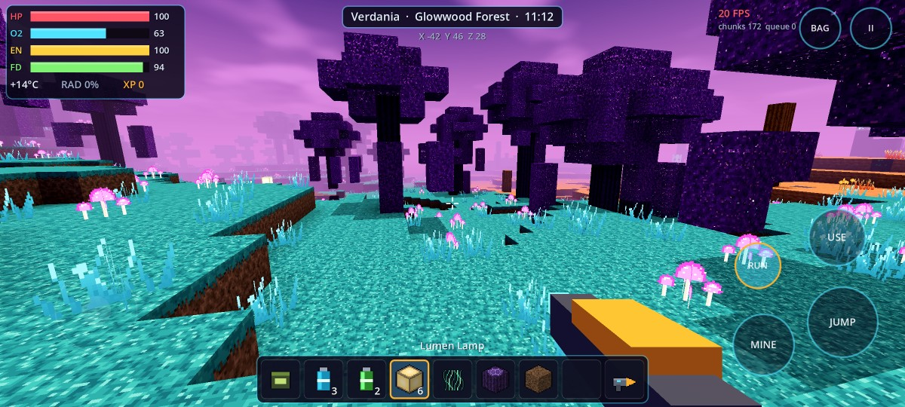

# PlanetCraft: Galactic Survival

An original 3D voxel sandbox for Android. Crash-land on an alien world, mine and build, automate a
colony, tame and hunt alien creatures, fly between six worlds and terraform dead planets into
living ones. The Kiroween hackathon build (v0.1.2) is fully offline; the Play Store build (v0.2.0+)
adds the cinematic intro, first-run field guide and the optional ad layer with Remove Ads.

Built with **Godot 4.7.2 (GDScript)** and developed with **Kiro CLI**. Kiroween 2026 entry,
**Frankenstein** category.

| | |
|---|---|
|  |  |
|  |  |
|  |  |

Screenshot on the reference phone (Redmi Note 11, Android 13):

## Download

- **APK:** the [latest GitHub Release](https://github.com/fareza777/planetcraft-kiro/releases/latest)
  is the offline v0.1.2 hackathon build. The store build (v0.2.0+) is exported from this branch with
  Gradle and Google test ad IDs; see [docs/BUILDING.md](docs/BUILDING.md). Replace the IDs and create
  the Play Console product before attaching it to a release.
- Requirements: Android 7.0+ (min SDK 24, target SDK 36), arm64-v8a, OpenGL ES 3.0 GPU. The
  offline v0.1.2 hackathon APK requests no permissions. The store build requests INTERNET and AD_ID
  for Google AdMob; Remove Ads turns every ad off. Gradle debug APKs are large (~140 MB because of
  the debug Godot template); release/AAB builds are much smaller.
- Tested on: Redmi Note 11 (Snapdragon 680, Adreno 610, Android 13). See [docs/TESTING.md](docs/TESTING.md).

## What is in the game (implemented and tested)

Everything listed here exists in this repository and was exercised by the automated tests or on
the reference device. See [docs/TESTING.md](docs/TESTING.md) for the exact results.

- **Voxel engine:** seed-based terrain for 6 worlds (heightmap, floating islands, asteroid field),
  caves, ore veins, crystal caverns, trees and plants. 16×16×128 chunk columns streamed on worker
  threads, greedy meshing with ambient occlusion, sky-light approximation, edit deltas saved per world.
- **Procedural art and audio:** all 78 block textures, every item icon, creature bodies, the sky,
  28 sound effects and the day/night music are generated by the game's code at startup. The repo
  contains no image or audio assets apart from the SVG app icon.
- **Survival:** health, oxygen, suit energy, food, body temperature, radiation; helmet lamp;
  jetpack; fall damage; storms; respawn at a med bay.
- **Building and crafting:** 61 placeable blocks, 75 data-driven recipes across hand, Fabricator,
  Smelter, Assembler and Refinery stations.
- **Colony and automation:** power grid (solar, battery, reactor), oxygen and heat zones,
  hydroponics, miner drones that fly out and mine ore, auto-smelting, storage crates, and
  production while you are on another planet (time-delta simulation).
- **Alien ecosystem:** 11 creatures with voxel bodies, procedural animation, wander/flee/chase/attack
  AI, distance-based update rates, taming, elite (★) variants and a boss (the Void Guardian).
- **Combat and loot:** ranged and melee weapons, projectiles, damage numbers, loot orbs, rarity tiers,
  16 items of rare rarity or higher, 6 gear recipes that need rare monster drops, a bestiary.
- **Vehicles and space:** drivable rover; launch pad, ship assembly (hull, engine tier, nav computer),
  star map and jumps between Verdania, Kryos, Pyrrhos, Aridus, Nullara and the Kessler Belt.
- **Story and NPCs:** 25-step main story in 6 chapters with narrated beats, 6 NPCs (Haven Outpost on
  Verdania plus survivors on other worlds), 14 side jobs, trading, HUD waypoints and a journal.
- **Living world:** day/night, weather (dust/ash storms, blizzards, spore rain), meteor showers that
  leave craters, gravity anomalies, swaying foliage, procedural structures with events
  (Obelisk trials, Starfall shrines, alien hives, crashed freighters).
- **Planet Evolution:** mining raises pollution; powered terraformers raise atmosphere, water and
  life, change the sky colour, convert ground to soil and grass, and eventually make air breathable.
- **Stellar Store:** cosmetic store on the title screen (suits, laser colours, rover and ship paint,
  starter kits) paid with Stellar Shards, a rare account-wide currency. In the store build an opt-in
  rewarded ad grants +25 shards, and a one-time Remove Ads purchase hides the ad layer.
- **App shell:** adaptive launcher icon, cinematic English voice-over title intro, F7 Developer brand
  ident, first-run three-page Field Guide (onboarding), Rate (Play Store link), Share (Android share
  sheet through Godot's AndroidRuntime), About with an accurate ads/privacy note and licence links.
- **UI:** touch controls (floating joystick, drag-look, tap-to-use, hold-to-mine, vector-icon buttons),
  keyboard and mouse on desktop, tabbed item screen, live settings (quality presets, view distance, resolution scale,
  field of view, bloom, clouds, auto-jump, camera shake, damage numbers, vibration, sensitivity,
  button size, invert Y, master and music volume, reset settings, delete save).

## Store build (v0.2.0+): ads and Remove Ads

This is the Play Store shell; the Kiroween v0.1.2 build remains fully offline. All ad and IAP code is
in the repository and was exercised on the reference phone, with Google's **test** IDs by default.

- **Banner** — title screen only, bottom-right, kept 56 dp clear of Android navigation bars and
  outside the menu buttons. Hidden during gameplay and whenever a menu overlay or the Field Guide is
  open.
- **Interstitial** — after a planet jump or a respawn, with a 60 s session warm-up, a 120 s gap and a
  maximum of two per session.
- **Rewarded** — opt-in "Watch ad · +25 Stellar Shards" in the Stellar Store. Verified on device:
  the test ad completed and the balance rose to 25.
- **Remove Ads** — one-time Google Play product `remove_ads`, USD 4.99 list (the store shows the local
  price when Play returns it). Removing ads hides the banner and interstitials, disables the rewarded
  prompt, persists in the local profile and can be restored after reinstalling. The Play Console
  product must be created before launch; a sideloaded debug build reports "Remove Ads is not available".
- **Consent** — Google UMP runs before the SDK initialises; Settings and About expose *Privacy options*.

Before publishing, replace the sample values in `project.godot`:
`admob/general/android/app_id`, `planetcraft/ads/banner_unit`, `planetcraft/ads/interstitial_unit`,
`planetcraft/ads/rewarded_unit`. See [docs/BUILDING.md](docs/BUILDING.md#admob-and-play-billing).

Planned work and known gaps are listed in [docs/ROADMAP.md](docs/ROADMAP.md).

## Controls

| Action | Touch | Desktop |
|---|---|---|
| Move | Left half: floating joystick | W A S D |
| Look | Drag on the right half | Mouse |
| Mine / fire weapon | Hold **MINE**, or long-press the right half | Left mouse |
| Use / place / talk / drive | Tap **USE**, or tap the right half | Right mouse or F |
| Jump / jetpack (hold in air) / exit rover | **JUMP** | Space |
| Sprint | **RUN** (toggle) | Shift |
| Hotbar | Tap a slot | 1–9, mouse wheel |
| Item screen | **BAG** | E or Tab |
| Pause and settings | **II** | Esc |

More in [docs/GAMEPLAY.md](docs/GAMEPLAY.md).

## Build from source

1. Install Godot **4.7.2** and its Android export templates
   (or run `python tools/fetch_android_templates.py 4.7.2` to fetch only the Android parts).
2. Configure the Android SDK and a debug keystore in Godot's editor settings (or the
   `GODOT_ANDROID_KEYSTORE_DEBUG_*` environment variables).
3. `godot --headless --path . --export-debug "Android" build/PlanetCraft-debug.apk`

Full steps, tests and CI details: [docs/BUILDING.md](docs/BUILDING.md).

## Architecture

Data-driven content in `data/*.json`, two autoloads (`Reg`, `Game`), a voxel core
(`scripts/voxel`), gameplay systems (`scripts/world`, `scripts/player`) and code-built UI
(`scripts/ui`). See [docs/ARCHITECTURE.md](docs/ARCHITECTURE.md).

## How Kiro was used

Steering docs, specs and the full development workflow are in [`.kiro/`](.kiro) and explained in
[docs/KIRO_DEVELOPMENT.md](docs/KIRO_DEVELOPMENT.md). The Frankenstein write-up is in
[docs/FRANKENSTEIN.md](docs/FRANKENSTEIN.md).

## License

Source code and all procedurally generated content: [MIT](LICENSE) © 2026 F7 Developer.
Third-party components and asset provenance: [THIRD_PARTY_NOTICES.md](THIRD_PARTY_NOTICES.md)
and [docs/ASSETS.md](docs/ASSETS.md).
